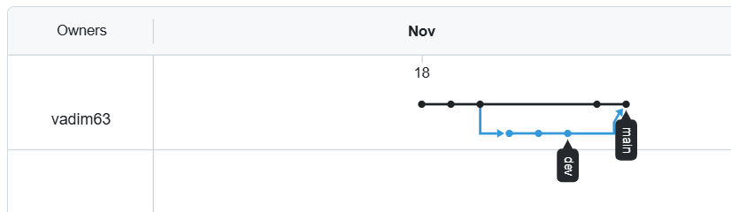
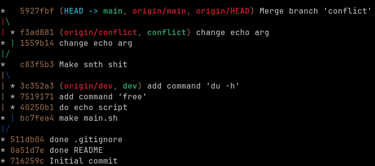

# Домашнее задание к занятию "Git" - Качьянов Вадим

### Задание 1

Ссылка на коммит: https://github.com/vadim63/task-8-03/commit/0a51d7e183dc550d66f01524d2a5c00316f8beb3

### Задание 2

Ссылка на коммит: https://github.com/vadim63/task-8-03/commit/511db040c300a41738dcfde1cb7a41ecde81b663

### Задание 3

Ссылка на граф коммитов: https://github.com/vadim63/task-8-03/network

### Задание 4

Ссылка на граф коммитов: https://github.com/vadim63/task-8-03/network

